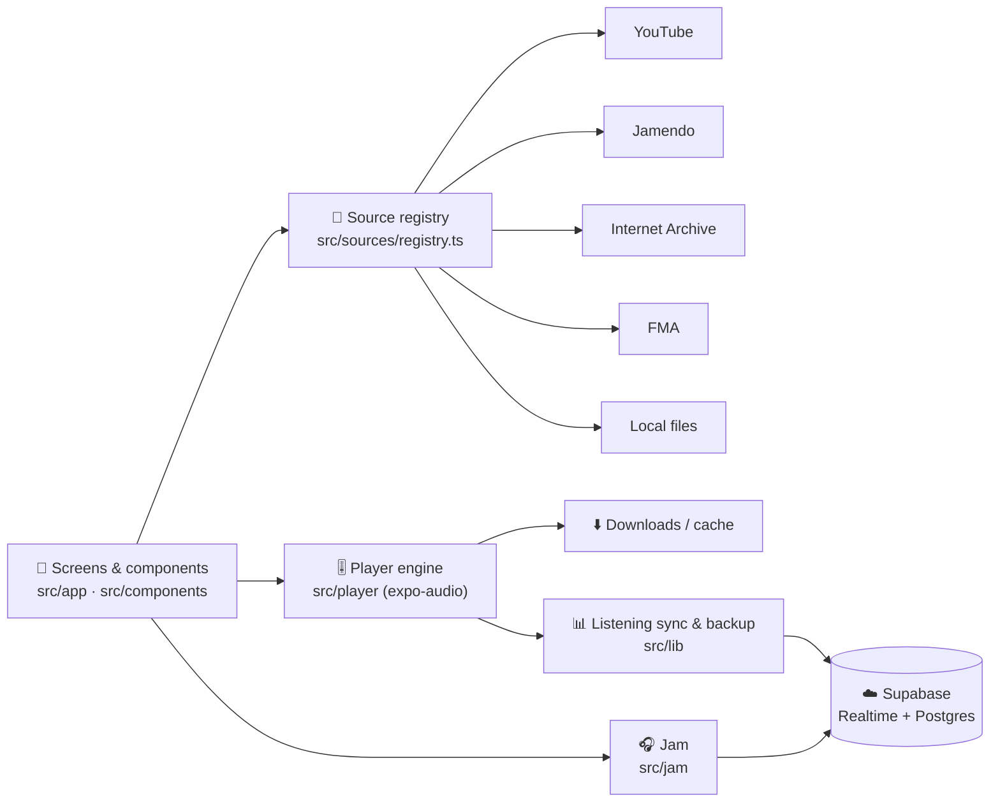

<div align="center">


<a href="https://github.com/DEV-GHILDIYAL/SONIQ">
  
</a>

<p>
  
  
  
  
</p>
<p>
  
  
  
  
</p>

</div>

---

## ✨ What is SONIQ?

**SONIQ** is a free, ad-free music player that pulls songs from many sources into one clean app — and lets you
**listen together with friends in real time**. Built with Expo + React Native, warm charcoal & amber design, and a
backend that keeps your data private.

> 🎧 Search once, play from anywhere: **YouTube · Jamendo · Internet Archive · Free Music Archive · your phone**

---

## 🔥 Features

<table>
<tr>
<td width="50%" valign="top">

### 🎵 Listening
- 🔎 **Unified search** across all sources, Spotify-style recents & suggestions
- 📴 **Background play** with lock-screen ⏮ ⏯ ⏭ and ±30 s controls
- ♾️ **Autoplay radio** — similar songs when the queue ends
- ⏩ **±30 s skip**, shuffle, repeat, smart queue
- 🌙 **Sleep timer** that fades out at the end of a song
- ⬇️ **Offline downloads** + **Save to phone** (Music folder)
- 📁 **Local files** — import your own MP3 / M4A / FLAC

</td>
<td width="50%" valign="top">

### 👥 Together
- 🎧 **Jam** — listen in sync with any number of friends
- ➕ Friends can **add songs** to the shared queue
- 🔁 Clock-synced playback, drift correction
- 🔥 **Daily streaks** with celebrations
- 💡 In-app **feature request** form
- 🎤 **Karaoke** — *coming soon*

</td>
</tr>
<tr>
<td valign="top">

### 📚 Library
- ❤️ **Liked Songs** with play / shuffle / download all
- 🗂️ **Playlists** with auto **2×2 cover collages**
- 👤 **Profile** with photo, SONIQ ID & streak card

</td>
<td valign="top">

### 🛡️ Account & privacy
- ☁️ **Cloud backup** of likes, playlists & history
- 🔑 **Backup code** restore after reinstall (no login)
- 🔒 Server-side functions only — nobody can read your data
- 🆕 **Optional update popup** for new versions

</td>
</tr>
</table>

---

## 🧱 Tech stack

| Layer | Tech |
|---|---|
| App | Expo SDK 58 · React Native 0.88 · React 19 · TypeScript (strict) · Expo Router |
| State | Zustand + AsyncStorage (persisted stores) |
| Audio | `expo-audio` (ExoPlayer) — only `src/player/` touches audio |
| YouTube | `youtubei.js` on-device (personal use), progressive stream (first chunk plays) · download only for offline/fallback · optional `server/` (Node + yt-dlp) fallback |
| Realtime & backend | Supabase Realtime (Jam) · Postgres + RLS + `security definer` functions |
| Files | `expo-file-system`, `expo-document-picker` |
| Tests | Jest + jest-expo + Testing Library |

---

## 🗺️ Architecture



**Rules of the codebase**
- Every source implements the `MusicSource` interface; UI only talks to the registry.
- Audio is controlled only from `src/player/` (enforced by ESLint).
- Keys live in `.env` (`EXPO_PUBLIC_*`), never in code.

---

## 🚀 Getting started

```bash
git clone https://github.com/DEV-GHILDIYAL/SONIQ.git
cd SONIQ
npm install            # patches expo-audio (lock-screen controls + Range streaming); the app builds it from source
cp .env.example .env   # fill in your keys
npx expo run:android   # dev build on a USB-connected phone
```

> **Native patch:** `expo-audio` is listed in `expo.autolinking.android.buildFromSource` (`package.json`) so
> `scripts/patch-expo-audio.js` actually compiles — otherwise Expo SDK 58 uses a prebuilt AAR. After changing
> those patches, rebuild with `npx expo run:android` (a Metro reload is not enough).

**`.env`**
```env
EXPO_PUBLIC_JAMENDO_CLIENT_ID=       # free key: developer.jamendo.com
EXPO_PUBLIC_SUPABASE_URL=            # Supabase project URL
EXPO_PUBLIC_SUPABASE_ANON_KEY=       # public anon key (never the service_role key)
```

**Backend (one time):** Supabase → SQL Editor → run [`supabase/setup.sql`](supabase/setup.sql) (also creates the public `avatars` bucket for profile photos) → Storage → create public bucket `apk`.
Details in [`docs/backend.md`](docs/backend.md).

---

## 📦 Release build

```bash
npx expo prebuild --platform android
cd android && ./gradlew assembleRelease
# → android/app/build/outputs/apk/release/app-release.apk  (~33 MB, arm64)
```

Release builds are signed with the key in `credentials/` (git-ignored — keep a private backup) and shrunk with R8
(`plugins/withAndroidSize.js`, `plugins/withReleaseSigning.js`).

---

## 🧪 Scripts

| Command | What it does |
|---|---|
| `npm start` | Metro dev server (needs the dev build) |
| `npm run android` | Native dev build + install |
| `npm test` | Jest test suite |
| `npm run typecheck` | TypeScript, strict |
| `npm run lint` | ESLint (incl. architecture rules) |

---

## 🛣️ Roadmap

- [x] Multi-source search & playback · background audio · lock-screen controls
- [x] Jam (listen together) · Liked songs · Downloads · Sleep timer · Autoplay
- [x] Streaks · Cloud backup & restore · Update popup · 33 MB APK
- [ ] 🎤 Lyrics (synced) → Karaoke
- [ ] 🔗 Playlist sharing
- [ ] ✨ "For you" recommendations
- [ ] 👥 Friends & group rooms

---

## ⚖️ Note

SONIQ is a personal, non-commercial project. Jamendo, Internet Archive and Free Music Archive content is used via their
public APIs under their licenses. The YouTube source exists for **personal use only** and is not part of any store build.

<div align="center">

**Made with 🧡 by [Dev Ghildiyal](https://github.com/DEV-GHILDIYAL)**


</div>
